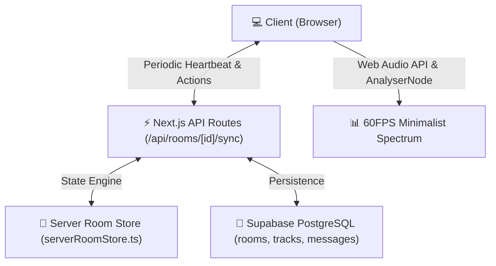

# 🤖 Harmoniq Developer & AI Agent Guide (`AGENT.md`)

This guide serves as the definitive reference for AI agents and human developers maintaining and extending **Harmoniq**, a production-grade, real-time synchronized music room platform.

---

## 🏛️ Architecture Overview

Harmoniq is architected as a **Server-Authoritative, Zero-Cost Cloud Synchronized Application** deployed on Vercel with a Supabase PostgreSQL backend.



### Key Architectural Tenets:
1. **Server-Authoritative Clock**:
   - The room owner/creator is merely a privileged user (`role: 'host'`), NOT the playback host.
   - The playback timeline, track progression, and pause/play states are calculated on the server.
   - If the room creator closes their browser or loses internet connectivity, the music stream and timeline continue uninterrupted for all other listeners.
2. **Hybrid Drift Correction**:
   - Small time drifts (< 1.2s): Resolved smoothly via soft playback rate scaling (`0.95x - 1.05x`) to prevent audible stuttering.
   - Significant drifts (> 1.2s): Instant hard seek to target server timestamp.
3. **Database Integration**:
   - Primary Cloud Database: **Supabase** (`rooms`, `tracks`, `room_messages`).
   - Resilient Fallback: Global in-memory Node process cache (`serverRoomStore.ts`) ensuring 100% uptime even during transient database outages.

---

## 📁 Repository Structure

```
├── AGENT.md                       # This AI agent and developer architectural guide
├── README.md                      # Public documentation & feature overview
├── package.json                   # Dependencies & scripts
├── tailwind.config.ts             # Tailwind design tokens
├── src/
│   ├── app/
│   │   ├── globals.css            # OLED minimal flat theme variables
│   │   ├── layout.tsx             # Root HTML layout with Vazirmatn font
│   │   ├── page.tsx               # Production Landing page (create, join, avatar)
│   │   ├── room/[id]/page.tsx     # Core collaborative listening room
│   │   └── api/
│   │       └── rooms/             # Serverless REST endpoints
│   │           ├── route.ts       # Room list and room creation
│   │           └── [id]/sync/     # Authoritative room sync & action dispatcher
│   ├── components/
│   │   ├── audio/
│   │   │   ├── SynchronizedPlayer.tsx # Ergonomic media controls, seek bar, volume
│   │   │   ├── AudioVisualizer.tsx    # Flat 60fps canvas frequency equalizer
│   │   │   └── LatencyIndicator.tsx   # Live RTT & drift status indicator
│   │   ├── room/
│   │   │   ├── RoomHeader.tsx         # Top bar with room code, server badge, share
│   │   │   ├── PlaylistQueue.tsx      # Interactive reorderable track list
│   │   │   ├── AddTrackModal.tsx      # Real streams, direct links, local file upload
│   │   │   ├── UserListModal.tsx      # Roster with role promotion, kick, and mute
│   │   │   ├── RoomSettingsModal.tsx  # Sleek toggle switches for room permissions
│   │   │   ├── RoomChat.tsx           # Real-time text chat with role badges
│   │   │   └── EmojiReactions.tsx     # Floating canvas particle reactions
│   │   └── ui/
│   │       └── ToggleSwitch.tsx       # Accessible modern flat toggle switch
│   ├── lib/
│   │   ├── serverRoomStore.ts     # Authoritative server clock & state manager
│   │   ├── supabaseClient.ts      # Configured Supabase client & table schemas
│   │   ├── audioContext.ts        # Singleton Web Audio API manager
│   │   ├── sampleTracks.ts        # Verified 24/7 internet radio & lofi streams
│   │   └── storage.ts             # Local user profile & mobile avatar storage
│   └── types/
│       └── room.ts                # TypeScript interfaces for rooms, tracks, roles
```

---

## 🔐 Environment Variables

| Variable | Required | Description |
| :--- | :--- | :--- |
| `NEXT_PUBLIC_SUPABASE_URL` | Optional | Supabase project URL (`https://<project-id>.supabase.co`) |
| `NEXT_PUBLIC_SUPABASE_ANON_KEY` | Optional | Supabase public anon key for database queries |
| `NEXT_PUBLIC_APP_URL` | Optional | Base URL for invite links and QR generation |

---

## 🛠️ Development & Deployment Workflows

### Local Development
```bash
npm install
npm run dev
```

### Production Build
```bash
npm run build
npm run start
```

### Continuous Deployment
Commits to the `main` branch automatically trigger Vercel preview/production deployments via the linked GitHub repository (`MRGhust/harmoniq`).
