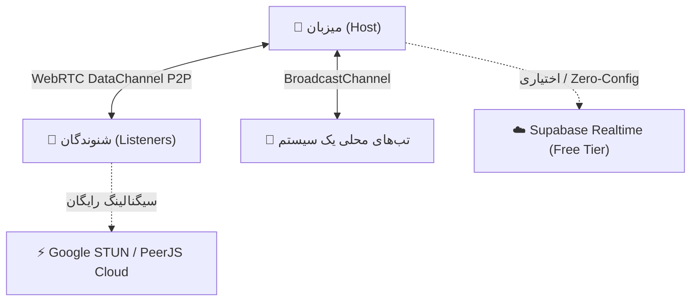

# 🎵 Harmoniq (هارمونیک)
> **پلتفرم پخش همزمان و هماهنگ موسیقی در اتاق‌های اختصاصی آنلاین**  
> *Real-Time Synchronized Music Listening Rooms with Zero Latency & Role-Based Controls*


<p align="center">
  
  
  
  
  
  
</p>

---

## 🌟 قابلیت‌ها و ویژگی‌های کلیدی (Features)

### 🎧 ۱. پخش ۱۰۰٪ همزمان و بدون تاخیر (Audio Synchronization)
- **موتور Drift Correction هوشمند**: تنظیم نرم سرعت پخش (`playbackRate: 0.92x - 1.08x`) برای انحراف‌های ریز زیر ۱ ثانیه تا هیچ لکنت یا پرش صدایی رخ ندهد.
- **پرش آنی (Hard Seek)**: در صورت پرش زمانی توسط دی‌جی، همه شنوندگان در کمتر از ۳۰ میلی‌ثانیه به ثانیه دقیق منتقل می‌شوند.
- **نمایشگر زنده پینگ و تاخیر (Latency Indicator)**: نمایش تاخیر میلی‌ثانیه‌ای هر کاربر با رنگ‌بندی سبز/زرد/قرمز و امکان همگام‌سازی دستی با یک کلیک (`Force Resync`).
- **کنترل صدای محلی (Independent Volume)**: هر کاربر ولوم صدای خودش را بدون اثرگذاری روی دیگران کنترل می‌کند.

### 👑 ۲. مدیریت نقش‌ها و دسترسی‌های اتاق (Roles & Permissions)
- **میزبان (Host)**: سازنده اتاق با اختیارات کامل (تنظیمات اتاق، ارتقا یا تنزیل نقش‌ها، اخراج کاربر Kick/Ban، پاکسازی صف).
- **دی‌جی (DJ / Co-Host)**: دسترسی کامل به کنترل‌های پخش (Play, Pause, Seek)، افزودن و حذف موزیک، و تغییر ترتیب صف.
- **ناظر (Moderator)**: نظارت بر چت و کاربران.
- **شنونده (Listener)**: گوش دادن همزمان، ارسال پیام در چت زنده و فرستادن ریکشن‌های معلق.
- **سوئیچ‌های امنیتی اتاق**: امکان قفل کردن کنترل پخش به هاست/دی‌جی، فعال یا غیرفعال کردن چت، یا خصوصی‌سازی اتاق با پسورد.

### 📜 ۳. صف پخش هوشمند و تنوع منابع صوتی (Smart Queue)
- **پشتیبانی از لینک صوتی مستقیم**: MP3, AAC, FLAC, OGG, WAV و استریم‌های رادیویی.
- **آپلود مستقیم فایل‌های لوکال**: بدون نیاز به سرور یا ذخیره‌سازی ابری، فایل‌های صوتی سیستم خود را اضافه کنید.
- **لایبرری داخلی آهنگ‌های ترند**: مجموعه‌ای از قطعات بدون کپی‌رایت سبک‌های Lo-Fi، Synthwave، Chill و Electronic.
- **مرتب‌سازی صف (Reorder)**: جابجایی ترتیب آهنگ‌ها به بالا و پایین.
- **حالت‌های پخش مکرر**: بدون تکرار، تکرار تک‌آهنگ (Loop Track)، یا تکرار کل صف (Loop Queue).

### 🎨 ۴. طراحی UI/UX خیره‌کننده و مدرن
- **استایل Glassmorphism & Cyber-Obsidian**: تم تاریک مینیمال با نورهای نئونی ارغوانی و فیروزه‌ای.
- **اکولایزر و ویژوالایزر صوتی کانوَس (Web Audio API)**: ۳ حالت بصری دیدنی (میله‌های فرکانسی نئونی، امواج سینوسی، و دایره‌ای ۳۶۰ درجه) با انیمیشن‌های ۶۰ فریم روان.
- **دیسک وینیل چرخان و بازوی سوزن صوتی (Turntable)**: چرخش واقعی دیسک و نشستن سوزن روی صفحه هنگام پخش با فیزیک طبیعی.
- **ریکشن‌های متحرک پروانه‌ای (Floating Reactions)**: پرواز ایموجی‌های ❤️, 🔥, 🎵, 🚀, 👏, 🎉 روی صفحه همه افراد همراه با ترقه‌های نورانی (`canvas-confetti`).
- **اشتراک‌گذاری آسان**: کپی لینک با یک کلیک و **تولید خودکار کد QR** برای ورود فوری با اسکن موبایل.
- **ریسپانسیو کامل**: هماهنگ با موبایل، تبلت و دسکتاپ به همراه مینی‌پلیر شناور ارگونومیک.

---

## 🏗️ معماری زیرساخت رایگان (Zero-Cost Architecture)

این پروژه طوری طراحی شده که **۱ ریال هم هزینه ندارد** و به هیچ سرور پولی، کارت بانکی خارجی یا دیتابیس اشتراکی نیازی ندارد:



1. **ارتباط مستقیم نظیر به نظیر (WebRTC DataMesh via PeerJS)**:
   - تبادل پیام‌ها و وضعیت پخش مستقیماً بین مرورگرها صورت می‌گیرد.
   - تاخیر زیر ۳۰ میلی‌ثانیه، مصرف صفر پهنای باند سرور، و دسترسی کامل در سرتاسر ایران بدون نیاز به فیلترشکن.
2. **هاستینگ رایگان در Vercel**:
   - فرانت‌اند و APIهای Next.js به طور کامل روی پلن رایگان Vercel مستقر می‌شوند.
3. **دیتابیس ابری رایگان (اختیاری)**:
   - برنامه بدون هیچ دیتابیسی به طور کامل و Out-of-the-Box کار می‌کند.
   - در صورت تمایل به ذخیره‌سازی پایدار، کافیست متغیرهای Supabase (پلن رایگان تا ۵۰۰ مگابایت دیتابیس و کانکشن‌های نامحدود) را در فایل `.env` وارد کنید.

---

## 🚀 راهنمای نصب و اجرای محلی (Quickstart)

### ۱. کلون کردن مخزن:
```bash
git clone https://github.com/MRGhust/harmoniq.git
cd harmoniq
```

### ۲. نصب وابستگی‌ها:
```bash
npm install
```

### ۳. اجرای سرور توسعه محلی:
```bash
npm run dev
```
حالا آدرس [http://localhost:3000](http://localhost:3000) را در مرورگر خود باز کنید!

### ۴. بیلد برای پروداکشن:
```bash
npm run build
npm start
```

---

## 🌐 راهنمای دیپلوی رایگان در Vercel (One-Click Deploy)

1. مخزن را در اکانت گیت‌هاب خود فورک کنید یا پوش کنید.
2. به سایت [Vercel.com](https://vercel.com) بروید و لاگین کنید.
3. روی دکمه **"Add New Project"** کلیک کنید و ریپازیتوری `harmoniq` را انتخاب نمایید.
4. بدون نیاز به تغییر هیچ تنظیمی، دکمه **"Deploy"** را بزنید!
5. پروژه ظرف ۲ دقیقه روی دامنه‌ای مثل `https://harmoniq.vercel.app` بالا می‌آید و آماده استفاده است.

---

## 🛠️ پشته فناوری (Tech Stack)

- **فریم‌ورک**: [Next.js 14 (App Router)](https://nextjs.org/)
- **زبان**: [TypeScript](https://www.typescriptlang.org/)
- **استایل‌دهی**: [Tailwind CSS](https://tailwindcss.com/)
- **انیمیشن‌ها**: [Framer Motion](https://www.framer.com/motion/) & [Canvas Confetti](https://www.kirilv.com/canvas-confetti/)
- **آیکون‌ها**: [Lucide React](https://lucide.dev/)
- **شبکه Realtime**: [WebRTC / PeerJS](https://peerjs.com/)
- **صوت و ویژوالایزر**: Web Audio API (`AnalyserNode`, `AudioContext`)
- **کیوآر کد**: [qrcode.react](https://github.com/zpao/qrcode.react)

---

## 🤝 مشارکت (Contributing)

مشارکت در توسعه پروژه، گزارش باگ‌ها و درخواست امکانات جدید همیشه استقبال می‌شود:
1. پروژه را Fork کنید.
2. یک شاخه جدید بسازید (`git checkout -b feature/AmazingFeature`).
3. تغییرات را کامیت کنید (`git commit -m 'feat: Add some AmazingFeature'`).
4. شاخه را پوش کنید (`git push origin feature/AmazingFeature`).
5. یک Pull Request باز کنید.

---

## 📄 لایسنس (License)

این پروژه تحت مجوز [MIT](LICENSE) به صورت کاملاً آزاد و متن‌باز منتشر شده است.
کاری از [MRGhust](https://github.com/MRGhust).
